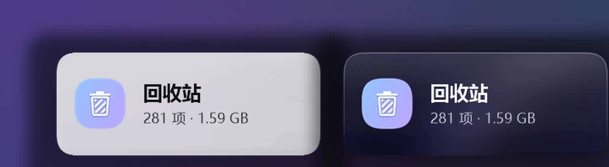
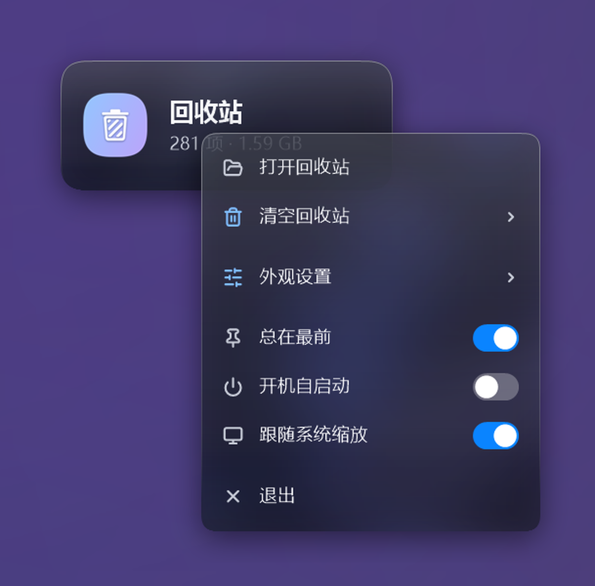
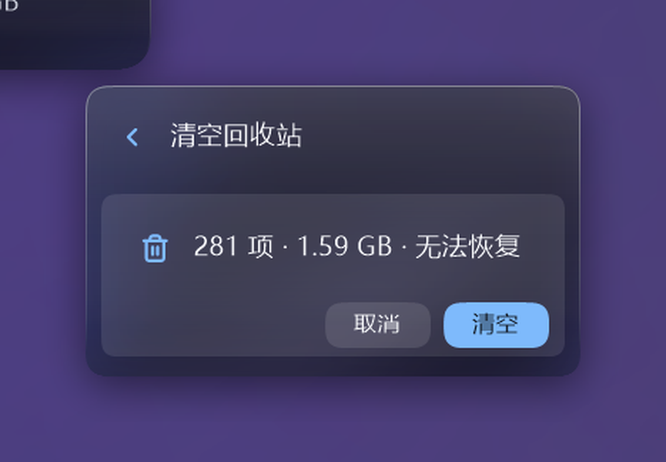

<div align="center">

# RecycleGlass

**Win11 风格的桌面回收站毛玻璃挂件 · 纯 C 实现**

双击打开 · 拖放回收 · 右键即设置

[官网与下载](https://3335957485wyf-spec.github.io/RecycleGlass/) · [更新日志](CHANGELOG.md)




</div>

---

## 这是什么

把回收站从桌面角落里的一枚图标，做成一张浮在壁纸上的玻璃卡片：实时显示项数和占用空间，
双击打开、把文件拖上去就回收，右键就能调外观。

**4.0 是一次整体重写：从 Python + PyInstaller 换成纯 C（Win32 + GDI+），单文件 0.83 MB。**
没有运行时、没有解包过程，双击就是原生窗口。

| | 3.x（Python 3.12 + PyInstaller） | 4.0（C） |
|---|---|---|
| 安装包 | 15.6 MB | **0.83 MB** |
| 相对体积 | 1× | **1 / 18.9** |
| 运行时 | 内置 Python 解释器、Pillow | 无，直接调 Win32 / GDI+ |
| 拖动时单帧 | 5.06 ms | **2.07 ms** |
| 空闲占用 | 1.6% 单核 | **1.1% 单核** |

（体积：16,391,384 → 869,129 字节；耗时在 2560×1600 @144Hz 上用同一套脚本实测。）

## 功能

- **双击卡片**打开回收站；**把文件/文件夹拖到卡片上**直接回收（支持多选）
- 实时显示 `项数 · 占用空间`，空/满两种图标状态
- 悬停浮出「打开 / 清空」；清空前有确认面板，明确写出会删掉多少项、多少体积
- 清空过程中显示 `正在清空… 剩余 N 项`，不会看着像卡死
- 右键菜单：打开回收站 / 清空回收站 / 外观设置 / 开机自启动 / 跟随系统缩放 / 退出
- 外观设置：透明度、材质浓度、模糊半径、主题（跟随系统 / 浅色 / 深色）、界面大小（小 / 标准 / 大）
- 玻璃材质：壁纸或屏幕实时模糊 + 超椭圆转角（n=3）+ 顶边高光衰减 + 内侧柔光；浅色深色两套配色
- 多显示器：卡片始终限制在工作区内，拖到屏幕边缘也不会跑丢
- 配置存在 `%APPDATA%\RecycleGlass\config.json`，日志在 `%LOCALAPPDATA%\RecycleGlass\recycleglass.log`

## 截图

<div align="center">





</div>

## 下载

到 Releases 下载 `RecycleGlass.exe`（0.83 MB），双击即可运行，绿色免安装。

**系统要求**：Windows 10 2004+ / Windows 11。
（用到了 `SetWindowDisplayAffinity(WDA_EXCLUDEFROMCAPTURE)` 让卡片把自己排除在截图之外，
Win10 2004 之前没有这个 API，实时模糊会退化成壁纸模糊。）

## 使用

| 操作 | 结果 |
|---|---|
| 双击卡片 | 打开回收站 |
| 把文件拖到卡片 | 移入回收站 |
| 悬停 →「打开」 | 打开回收站 |
| 悬停 →「清空」 | 弹出确认面板，确认后清空 |
| 右键卡片 | 打开菜单 |
| 菜单 →「退出」 | 关闭挂件 |

## 外观设置

| 项 | 作用 |
|---|---|
| 透明度 | 卡片整体不透明度（含按钮、文字） |
| 材质浓度 | 底色浓度：越低越透，越高越实 |
| 模糊半径 | 背景模糊强度 |
| 主题 | 跟随系统 / 浅色 / 深色 |
| 界面大小 | 小 / 标准 / 大 |
| 跟随系统缩放 | 按显示器 DPI 放大卡片 |

模糊半径按显示器缩放系数放大，所以 125% / 150% 屏上的玻璃和 100% 屏看起来一样糊。

## 从源码构建

只需要一个 C 编译器，没有第三方依赖。源码同时给出两套构建脚本：

**MSVC**（在 “x64 Native Tools Command Prompt” 里）：

```bat
build.bat
```

**MinGW-w64**：

```bash
make            # 产物 build/RecycleGlass.exe
```

两者产出的都是同一个单文件 exe（约 0.83 MB），链接
`gdiplus / shell32 / ole32 / oleaut32 / uuid / shlwapi / user32 / gdi32 / advapi32`。

### 自动构建

`.github/workflows/build.yml` 会在每次 push 到 `main` 时：

1. 在 Windows 上编译出 exe，作为构建产物保存 30 天；
2. 把 `site/` 同步到 `gh-pages` 并触发一次 Pages 构建，官网随之更新。

打 `v*` 标签（例如 `v4.0.0`）会额外把 exe 挂到同名 Release 上。

## 项目结构

```
src/
  main.c         窗口、消息循环、拖动、托盘、拖放、配置落盘
  render.c       卡片绘制：玻璃合成、超椭圆、边光层、阴影、文字
  glass.c        背景引擎：抓屏/壁纸 → 半分辨率平面 → box blur → 双线性裁剪
  menu.c         右键菜单：行布局、开关、滑杆、分页、动画、确认面板
  icon.c         Lucide 图标几何（烘焙成折线，运行时只描边）
  config.c       配置读写与迁移
  i18n.c         中英文案
  droptarget.c   OLE IDropTarget（把文件拖进卡片）
  shell.c        回收站读写与体积格式化
res/
  app.rc         图标 + VERSIONINFO
  app-icon.ico   多尺寸图标（16–256）
site/            官网（推到 gh-pages）
```

## 实现要点

想改代码的话，几个不太显然的地方：

- **窗口**：分层窗口 + `UpdateLayeredWindow`，逐像素 alpha；卡片和菜单都是自绘的。
  移动窗口和上传画面合成一次 ULW 调用，拖动时不会出现「先移窗、后补图」的双帧感。
- **背景引擎（4.0 的核心）**：抓屏 `BitBlt` 被合成器锁在 ~6 ms，逐帧再糊整张卡片又是 4 ms，
  一趟拖动就卡在这里。现在的工作单位是**平面**：比卡片大一圈、半分辨率的图，抓一次、糊一次，
  每帧只做双线性裁剪（0.4 ms）。模糊是 3 次 box blur（前缀和，O(1)/像素），耗时与半径无关；
  卡片走出平面范围才重抓。壁纸整屏平面常驻，改半径只重糊不重绘。
- **边光**：不是渐变笔刷（GDI+ 两色 line brush 上 `GdipSetLinePresetBlend` 是空操作），
  而是一张缓存层：1.4 px 白线压在轮廓上，逐行按实测曲线衰减（顶部 alpha 92 → 92% 高度归零），
  再用卡片自身蒙版裁剪，底边因此不会残留亮线。
- **转角**：卡片和面板用超椭圆 `|x|^n+|y|^n=1`（n=3），开关、滑杆用 n=2 的真圆角胶囊，
  免得轨道是「鼓形」而滑块是正圆，看着外方内圆。
- **DPI**：`GetDpiForWindow` + 次线性缩放 `(dpi/96)^0.4`；模糊半径另乘缩放系数。
- **配置**：写盘走临时文件 + `MoveFileEx` 替换，断电不会写坏。

## 已知限制

- 清空走系统的 `SHEmptyRecycleBin`，几万项时会比较慢（界面会实时显示剩余项数）
- 托盘图标有系统缓存，换图标后需要重启资源管理器或重新登录才刷新

## 许可

[MIT](LICENSE) © 2026 氦-3

图标几何来自 [Lucide](https://lucide.dev)（ISC）；形变/采样算法参考了
[morphicons](https://www.morphicons.com)（MIT），仅在生成阶段使用，不随程序分发。

> 3.x 的 Python 源码仍保留在 `recycle_glass/` 与 `run.py` 里，作为原型参考；
> 4.0 起的正式版本由 `src/` 下的 C 代码构建。
