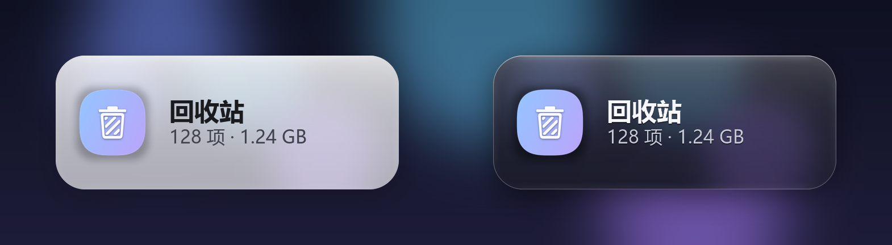
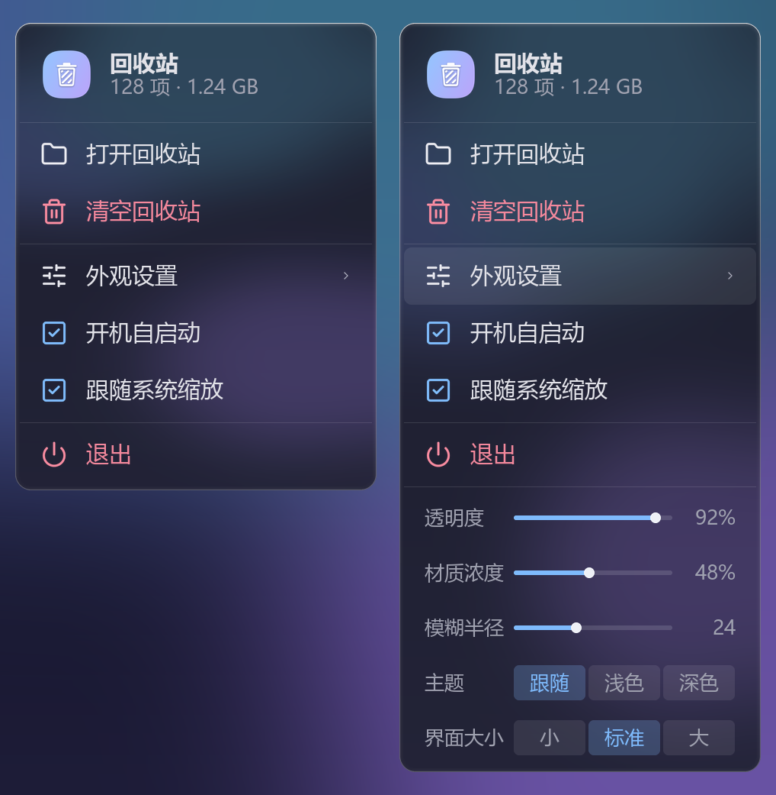
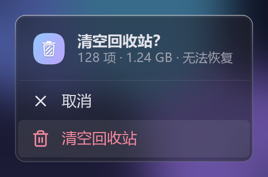

<div align="center">

# RecycleGlass

**Win11 风格的桌面回收站毛玻璃挂件**

双击打开 · 拖放回收 · 右键即设置

[官网与下载](https://3335957485wyf-spec.github.io/RecycleGlass/) · [更新日志](CHANGELOG.md)




</div>

---

## 这是什么

把回收站从桌面角落里的一枚图标，做成一张浮在壁纸上的玻璃卡片：实时显示项数和占用空间，
双击打开、把文件拖上去就回收，右键就能调外观。单文件 exe，不需要装 Python 或任何运行时。

## 功能

- **双击卡片**打开回收站；**把文件/文件夹拖到卡片上**直接回收（支持多选）
- 实时显示 `项数 · 占用空间`，空/满两种图标状态
- 悬停浮出「打开 / 清空」；清空前有确认面板，明确写出会删掉多少项、多少体积
- 清空过程中显示 `正在清空… 剩余 N 项`，不会看着像卡死
- 右键菜单：打开回收站 / 清空回收站 / 外观设置 / 开机自启动 / 跟随系统缩放 / 退出
- 外观设置：透明度、材质浓度、模糊半径、主题（跟随系统 / 浅色 / 深色）、界面大小（小 / 标准 / 大）
- 玻璃材质：壁纸模糊取色 + 超椭圆转角（n=3）+ 顶部高光 + 内侧柔光；浅色深色两套配色
- 多显示器：卡片始终限制在工作区内，拖到屏幕边缘也不会跑丢
- 配置存在 `%APPDATA%\RecycleGlass\config.json`，日志在同目录 `logs\`

## 截图

<div align="center">





</div>

## 下载

到 Releases 下载 `RecycleGlass.exe`，双击即可运行，绿色免安装。

**系统要求**：Windows 10 2004+ / Windows 11。
（用到了 `SetWindowDisplayAffinity(WDA_EXCLUDEFROMCAPTURE)` 让菜单把自己排除在截图之外，
Win10 2004 之前没有这个 API，菜单背景会退化成壁纸模糊。）

## 使用

| 操作 | 结果 |
|---|---|
| 双击卡片 | 打开回收站 |
| 把文件拖到卡片 | 移入回收站 |
| 悬停 →「打开」 | 打开回收站 |
| 悬停 →「清空」 | 弹出确认面板，确认后清空 |
| 右键卡片 | 打开菜单 |
| 菜单 →「退出」 | 关闭挂件 |

## 外观设置

| 项 | 作用 |
|---|---|
| 透明度 | 卡片整体不透明度（含按钮、文字） |
| 材质浓度 | 底色浓度：越低越透，越高越实 |
| 模糊半径 | 背景模糊强度 |
| 主题 | 跟随系统 / 浅色 / 深色 |
| 界面大小 | 小 / 标准 / 大 |
| 跟随系统缩放 | 按显示器 DPI 放大卡片 |

**关于「跟随系统缩放」**：缩放是次线性的，`(dpi/96)^0.4`。
100% 时正好是基准尺寸，150% 时约 1.18 倍，200% 时约 1.32 倍——
等比放大（150% 直接 ×1.5）在高分屏上会大得离谱，所以做了衰减。

## 从源码运行

```bash
python -m pip install pillow
python run.py
```

## 打包

```bash
python -m pip install -r requirements.txt
python -m PyInstaller --noconfirm build.spec
```

产物是 `dist/RecycleGlass.exe`（单文件，约 16 MB）。
`build.spec` 里已经带上了图标和版本资源。

### 自动构建

`.github/workflows/build.yml` 会在每次 push 到 `main` 时：

1. 在 Windows 上跑 PyInstaller 打出同样的单文件 exe，作为构建产物保存 30 天；
2. 把 `site/` 同步到 `gh-pages` 并触发一次 Pages 构建，官网随之更新。

打 `v*` 标签（例如 `v3.2.0`）会额外把 exe 挂到同名 Release 上，Release 说明自动生成。

## 项目结构

```
recycle_glass/
  app.py          窗口、消息循环、交互、设置、托盘、拖放
  render.py       卡片绘制（玻璃材质、文字、按钮、阴影）
  menu.py         右键菜单（自绘、动画、命中测试）
  bin.py          回收站读写（SHQueryRecycleBin / SHEmptyRecycleBin / SHFileOperation）
  desktop.py      钉到桌面层、UpdateLayeredWindow
  wallpaper.py    壁纸读取与模糊
  screencap.py    屏幕实时抓取（菜单背景）
  icons.py        Lucide 图标几何（烘焙成折线）
  screens.py      多显示器与 DPI
  config.py       配置读写与迁移
  i18n.py         中英文案
  diag.py         日志与崩溃捕获
  assets/         图标、版本用图
tools/
  make_icons.py   从源图生成多尺寸 ico（含小尺寸重绘）
  check_menu.py   截取菜单实际合成效果
  check_click.py  点击链路自测
```

## 实现要点

想改代码的话，几个不太显然的地方：

- **窗口**：分层窗口 + `UpdateLayeredWindow`，逐像素 alpha，卡片和菜单都是自绘的
- **钉在桌面层**：`SetParent` 到 `Progman` 的锚点窗口（`WorkerW` 兜底），所以它不会被「显示桌面」藏起来
- **卡片背景**：读当前壁纸做高斯模糊；**菜单背景**：实时 `BitBlt` 抓屏再模糊，
  并用 `WDA_EXCLUDEFROMCAPTURE` 把自己排除在截图外，否则会把上一帧的自己拍进去
- **菜单图标**：Lucide 的几何离线烘焙成折线（`icons.py`），运行时只做 `ImageDraw.line`，
  没有 SVG 解析、没有曲线运算
- **版本资源**：`version_info.txt` 由 PyInstaller `eval()` 加载，**必须是单个表达式**，
  写模块 docstring 会直接构建失败

## 已知限制

- 清空走系统的 `SHEmptyRecycleBin`，几万项时会比较慢（界面会实时显示剩余项数）
- 托盘图标有系统缓存，换图标后需要重启资源管理器或重新登录才刷新

## 许可

[MIT](LICENSE) © 2026 氦-3

图标几何来自 [Lucide](https://lucide.dev)（ISC）；形变/采样算法参考了
[morphicons](https://www.morphicons.com)（MIT），仅在生成阶段使用，不随程序分发。
